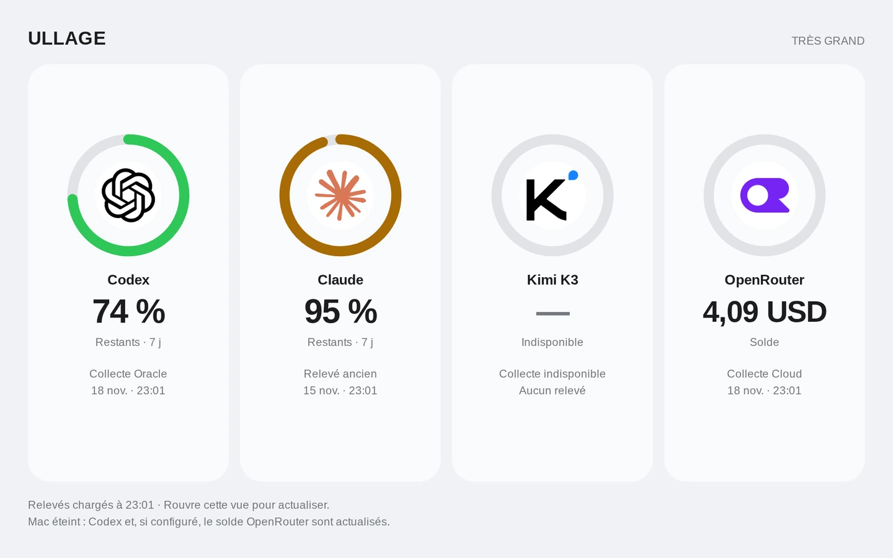

# Romain Cournol

Je travaille dans la vente à Lausanne. J’écris surtout du TypeScript pour le web et du Swift pour le Mac.

## DealCraft

J’ai construit DealCraft pour passer de mes notes de rendez-vous à une première offre média. Le modèle m’aide à rédiger le brouillon. Pour le montant, DealCraft applique en local le tarif du catalogue public au volume demandé.

Dans cet exemple, Studio Arolle demande 100 000 impressions. Je peux remonter des 3 000 CHF proposés au tarif de 30 CHF le mille. [Voir le brief fictif](assets/dealcraft-brief.webp)

## Rally

Un ping-pong à Lausanne ce soir ? Dans Rally, je choisis une heure et un quartier. L’app me propose des joueurs disponibles, puis ouvre une salle pour fixer le rendez-vous.

Le filtre de distance fonctionne dans les deux sens. Si je suis prêt à parcourir trois kilomètres et que l’autre joueur en a choisi un seul, l’app respecte nos deux limites.

## Ullage

J’ai écrit Ullage en Swift pour voir mes quotas Claude Code et Codex depuis la barre de menus du Mac. Un quota à 95 % m’est moins utile si le chiffre date de trois jours. Le widget compagnon affiche donc aussi la date du relevé, comme dans cet aperçu avec des données fictives.

