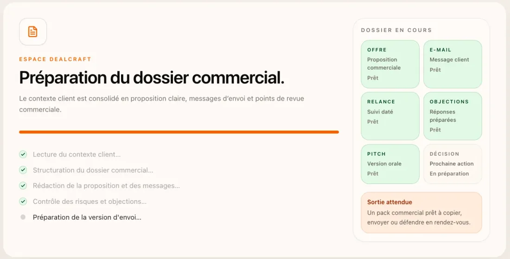
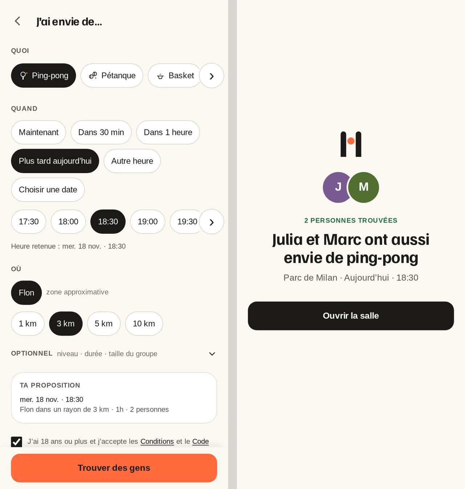

# Romain Cournol

Je travaille dans la vente B2B depuis huit ans. Chez Tamedia, près de Lausanne, je partage mon temps entre la vente, le CRM et les outils IA. J’ai par exemple construit un calculateur qui permet à mes collègues de chiffrer un contenu pendant le rendez-vous client. Plus de 50 commerciaux l’utilisent.

[Mon portfolio](https://romaincournol.ch/fr/) · [Portfolio in English](https://romaincournol.ch/en/) · [LinkedIn](https://www.linkedin.com/in/romain-cournol/)

## DealCraft · Du brief à l’offre média

En sortant d’un rendez-vous, j’ai souvent des notes en vrac, un budget et quelques questions encore ouvertes. J’ai construit DealCraft pour préparer l’offre et l’e-mail de suivi à partir de ces notes. L’IA s’occupe de la rédaction. Pour chiffrer l’offre, l’application applique un barème public et indique la source du prix.

Un cas que je teste dans le code est celui d’un annonceur qui demande **100 000 impressions avec un plafond de 3 000 CHF**. Le test vérifie que l’outil distingue la quantité du budget, retrouve le prix dans le catalogue et contrôle que la proposition respecte le plafond.

[Voir l’étude de cas et la démo publique](https://romaincournol.ch/fr/parcours/dealcraft/)

## Rally · Organiser une sortie à plusieurs

J’ai construit Rally pour qu’une idée comme « un ping-pong à Lausanne ce soir » puisse devenir un rendez-vous. Chacun propose une activité, un moment et un quartier. Les participants se retrouvent ensuite dans une salle de groupe pour régler les détails.

Pour savoir si Rally rend service, j’ai choisi de suivre **la part des envies de sortie qui aboutissent à une activité déclarée réalisée**. Cette logique se retrouve aussi dans les tests. Quand deux personnes demandent la dernière place au même instant, un test vérifie qu’une seule l’obtient.

[Découvrir le parcours web et iOS de Rally](https://romaincournol.ch/fr/parcours/rally/)
